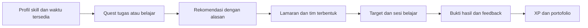

# Audit PartyUp: Mobile dan Kesiapan Lomba

Tanggal: 6 November 2026. Dasar pemeriksaan: kode dalam checkout ini, teks rekomendasi yang dilampirkan, dan sumber resmi yang ditautkan. Ketentuan APK belum diketahui; rekomendasi awal memakai web mobile sebagai tahap pertama. Dokumen ini merupakan analisis dan usulan, bukan daftar fitur yang sudah selesai.

## 1. Keputusan produk

**Posisikan PartyUp sebagai pendamping kolaborasi belajar mahasiswa: menemukan rekan yang cocok, membentuk tim, dan menghasilkan bukti belajar bersama.** Identitas quest, party, avatar, dan XP mendukung tujuan tersebut.

Alur utama yang disarankan:



Contoh demo: mahasiswa mencari dua rekan untuk tugas mata kuliah, memilih berdasarkan skill dan jadwal yang beririsan, menerima lamaran, menyelesaikan satu milestone, lalu mengunggah hasil untuk mendapat feedback. Skenario ini menghubungkan kolaborasi dan pembelajaran dalam satu pengalaman.

## 2. Kesesuaian dengan lomba

[Halaman resmi GDGoC ITB Challenge 2026](https://gdgoncampusitb.com/hackathon) mencantumkan Case 1, **Smarter Campus and Learning**, dengan area pengalaman akademik, layanan/fasilitas kampus, dan kolaborasi mahasiswa. Situs juga menyebut teknologi Google. Preliminary berupa abstrak sesuai template, dalam PDF maksimal 10 MB.

Jadwal publik saat diperiksa: pendaftaran sampai **7 November**, preliminary **10 November**, semifinal **30 November**, final **16 Desember 2026**. Jadwal dapat berubah; jam penutupan perlu mengikuti dashboard/pengumuman panitia.

Rubrik berbobot dan isi template abstrak belum berhasil diperoleh dari sumber publik yang diperiksa. Karena itu, tabel berikut adalah **pemetaan usulan terhadap tema**, bukan rubrik penilaian resmi. Belum ada dasar publik yang ditemukan untuk menyebut semua area wajib dipenuhi sekaligus, Kotlin mendapat nilai tambahan, atau APK wajib.

| Area tema | Kontribusi PartyUp yang disarankan | Bukti yang bisa diperlihatkan |
| --- | --- | --- |
| Kolaborasi mahasiswa | Quest akademik, pencocokan skill/jadwal, lamaran, roster tim | Dua akun pada perangkat berbeda melihat anggota dan status tim yang sama |
| Pengalaman belajar | Target belajar, milestone, sesi, unggahan hasil dan feedback | Satu aktivitas selesai dengan artefak dan review yang dapat dibuka |
| Layanan/fasilitas | Tahap lanjutan: direktori lokasi belajar atau permintaan ruang | Sumber informasi nyata; status permintaan jelas. Booking resmi menunggu integrasi pengelola |
| Efektivitas dan inklusivitas | Mobile mudah dipakai, koneksi lambat tertangani, pemula bisa mendapat peran | Uji tugas pengguna, waktu membentuk tim, tingkat penyelesaian dan hambatan pengguna |
| Teknologi Google | Gemini untuk mengubah brief tugas menjadi usulan rencana belajar | Input brief, hasil terstruktur, langkah yang diedit dan disetujui mahasiswa |

Saran fokus: kuatkan dua area pertama. Tambahkan layanan kampus jika ada kebutuhan dan akses operasional yang nyata. Jumlah integrasi bukan pengganti bukti manfaat.

## 3. Kondisi kode saat ini

Fondasi yang tersedia: Next.js App Router, React, Tailwind, komponen bersama, quest board, pencarian/filter, form quest, apply/invite, profil/portofolio, feed, kuis, serta service Supabase opsional. Beberapa grid sudah mempunyai breakpoint responsif.

Namun, kondisi yang paling akurat adalah **prototipe web interaktif dengan data lokal dan upaya sinkronisasi cloud opsional**. Keberadaan SDK Supabase belum membuktikan autentikasi, permission, sinkronisasi antarperangkat, dan workflow tim sudah selesai.

| Prioritas | Temuan pada kode | Dampak dan tindakan |
| --- | --- | --- |
| P0 | `src/app/login/page.js:110` menerima password demo global; `:113` mengungkap password saat gagal; sesi berupa objek lokal pada `:120` | Pisahkan demo berlabel dari akun nyata. Gunakan auth provider dan aturan akses backend; role dalam localStorage bukan dasar otorisasi |
| P0 | `src/services/dataService.js:42` dan fungsi write lain menulis lokal terlebih dahulu, lalu mengabaikan hasil `{ error }` cloud | Pesan sukses belum menjamin data tersimpan di server. Periksa hasil write, tampilkan pending/error/retry, baru konfirmasi keberhasilan |
| P0 | `src/app/profile/page.js:165` dan `:207` menerima invite/lamaran dengan mengubah status; belum ada entitas tim/anggota yang ditemukan | Bentuk `teams` dan `team_members` melalui operasi atomik, cek kapasitas dan cegah anggota ganda |
| P0 | `src/app/profile/page.js:173` dan `src/app/quiz/page.js:227` menaikkan semester sebagai reward | Pisahkan semester akademik dari XP. Semester tidak berubah saat menerima undangan atau menang kuis |
| P0 | `src/components/Chatbot.js:91` dan `:98`: offset kanan 24px dengan lebar 360px | Dari aturan CSS, panel melewati kiri layar 360px sebesar 24px. Gunakan panel selebar viewport dengan margin aman atau layar penuh mobile |
| P0 | `src/components/Header.js:186` dan `:197`: logo, lima menu, serta kontrol akun dalam satu baris | Navigasi berisiko terjepit di HP. Ringkas app bar dan gunakan empat tujuan navigasi utama |
| P1 | `src/services/dataService.js:9` dan `:31` menganggap hasil cloud valid hanya bila tidak kosong | Database kosong dapat memunculkan seed/cache lama. Bedakan empty state, error, offline, dan mode demo |
| P1 | `src/app/board/page.js:167` otomatis memberi `is_verified: true`; `ProjectCard.js:222` memakai `isVerified` | Satukan kontrak data. Default belum diverifikasi; catat jenis verifikasi, reviewer, waktu, dan bukti |
| P1 | `src/app/showcase/page.js:153` membuat rank, quality score, dan status Production Ready dari indeks | Angka tersebut bukan asesmen. Hilangkan atau tandai sebagai contoh; tampilkan kontribusi, artefak, dan review yang benar-benar ada |
| P1 | `src/components/home/HomeStats.js:24` menetapkan 342 anggota, 1.208 misi, dan 94% matching | Jangan gunakan sebagai hasil pilot. Hitung metrik dari data nyata atau tampilkan label data demo |
| P1 | `src/app/board/page.js:107` hanya memfilter teks, role, kategori; `:161` mencampur role dan teknologi | Belum ada ranking kecocokan. Pisahkan skill, peran, mata kuliah, jadwal, kapasitas dan mode pertemuan |
| P1 | `src/app/board/page.js:419` form modal tanpa batas tinggi dan area isi yang dapat digulir | Tombol submit berisiko tertutup keyboard HP. Gunakan sheet mobile dengan konten scroll dan aksi yang terjangkau |
| P1 | `src/app/globals.css:103` dan `:130` mengganti warna kelas secara global; sebagian panel tetap gelap | Mode terang berpotensi menghasilkan teks gelap di atas panel gelap. Ganti dengan token semantik |
| P1 | `src/components/PixelButton.js:14` menghapus outline; banyak label/kontrol menggunakan font pixel 7–9px | Tambah focus ring, font kerja yang terbaca, target sentuh memadai, serta dialog dan kontrol semantik |
| P2 | `README.md` menyebut INVENTION dan static export; `next.config.mjs` tidak lagi mengaktifkan export dan ada API chat | Perbarui narasi dan instruksi deployment sesuai target lomba serta runtime sebenarnya |

Event `window.dispatchEvent` hanya menyinkronkan state pada konteks browser terkait; implementasi itu belum membuktikan notifikasi realtime lintas perangkat. Belum ditemukan penggunaan Supabase Auth, subscription realtime, migration/RLS, manifest PWA atau service worker dalam source aplikasi yang diperiksa. Konfigurasi RLS dan data di dashboard Supabase tidak diperiksa, sehingga kondisinya tidak dapat disimpulkan dari audit ini.

API chat pada `src/app/api/chat/route.js:103` memakai Groq dan mempunyai FAQ fallback. Itu belum merupakan study agent atau mesin pencocokan akademik.

## 4. Pilihan mobile dan struktur sistem

| Kondisi | Pilihan awal | Alasan |
| --- | --- | --- |
| Web diterima atau APK belum diwajibkan | Perbaiki web mobile, lalu tambahkan PWA bila diperlukan | Memanfaatkan implementasi yang ada dan memberi ruang untuk memperbaiki alur inti sebelum preliminary |
| APK diwajibkan atau fungsi native terbukti penting | Expo/React Native dengan backend bersama | Sesuai pengalaman React; siapkan waktu untuk UI native, navigasi, sesi, build dan pengujian perangkat |
| Tim sudah mempunyai spesialis Android dan scope Android saja | Kotlin dapat dipertimbangkan | Keputusan berdasarkan kapasitas tim dan kebutuhan, bukan asumsi preferensi juri |

Web responsif saat ini belum otomatis menjadi PWA. Penambahan manifest, ikon instalasi, dan kebijakan cache/offline merupakan pekerjaan terpisah. Jangan memberi kesan lamaran sudah terkirim saat perangkat offline dan server belum menerimanya.

Klaim reuse Next.js ke native sebesar 80% belum didukung kode ini. [Dokumentasi Expo](https://docs.expo.dev/workflow/web/) menjelaskan bahwa elemen DOM seperti `div` dan `p` tidak dirender sebagai komponen native. UI berbasis HTML, `next/link`, `next/image`, CSS web, localStorage dan custom event perlu adaptasi. Model, validasi, fungsi pencocokan dan aturan XP dapat dibagi setelah dipisahkan dari browser.

Refactor bertahap dalam repo yang ada:

```text
src/
  app/                  # route dan komposisi halaman
  features/
    auth/
    quests/
    parties/
    learning/
    portfolio/
  domain/
    matching/           # fungsi murni, aturan dan alasan kecocokan
    gamification/       # aturan XP dan event yang memenuhi syarat
    validation/
  services/             # repository backend dan hasil operasi terstruktur
  components/ui/        # tombol, field, card, dialog/sheet
  theme/                # token warna, typography, spacing
```

`profile/page.js` sebaiknya menjadi komposisi komponen ringkas, bukan tempat auth, storage, undangan, reward, serta seluruh tampilan dikelola sekaligus. Gunakan session provider dan hooks fitur. UI web tetap boleh berbeda dari UI native.

Jika Expo benar-benar dimulai, barulah ekstrak paket bersama ke `apps/web`, `apps/mobile`, `packages/domain`, `packages/data`, dan `packages/design-tokens`. Restrukturisasi monorepo besar tidak menjadi syarat sebelum submission abstrak.

Backend minimum:

- `profiles`, `courses`, `quests`, kebutuhan peran/skill, availability.
- `applications`, `invitations`, `teams`, `team_members`.
- `milestones`, `submissions`, `reviews`, `xp_events`.
- `notifications` jika ada alur inbox atau pemberitahuan tersimpan.

Gunakan ID yang dibuat backend/UUID, status baku, relasi yang jelas, dan satu konvensi field. Transaksi menerima anggota harus memvalidasi pemilik, status pending, kapasitas, serta keunikan anggota. Aturan akses harus diuji dengan user yang berbeda.

Contoh aturan gamifikasi yang dapat dipahami: `semester` tetap data akademik, sedangkan XP berasal dari event penyelesaian milestone dengan bukti. Gunakan kunci unik pada event agar tombol yang ditekan dua kali tidak menggandakan reward. Jangan memakai senioritas atau jumlah skill yang ditulis sendiri sebagai bukti kemampuan.

## 5. Struktur pengalaman dan desain mobile

Navigasi utama yang diusulkan: **Beranda · Quest · Party · Profil**.

| Layar | Isi utama | Keputusan desain |
| --- | --- | --- |
| Beranda setelah login | Tindakan berikutnya, undangan, deadline, sesi terdekat | Dahulukan pekerjaan pengguna; landing marketing tetap untuk pengunjung baru |
| Quest | Tugas kuliah, kelompok belajar, proyek/lomba; filter course, skill, jadwal | Kartu menunjukkan tujuan, kebutuhan peran, waktu dan slot anggota; satu CTA utama |
| Party | Anggota, target, tugas, bukti hasil, inbox lamaran/undangan | Hubungkan proses rekrutmen dengan aktivitas setelah tim terbentuk |
| Profil | Bio singkat, skill yang dicantumkan, availability, karya, XP | Ringkas identitas; settings, bahasa, tema dan panduan berada di sini |

Pertahankan pixel pada logo, avatar, badge, XP dan selebrasi. Gunakan Inter untuk judul kerja, navigasi, form dan teks utama. Pertahankan karakter PartyUp melalui ilustrasi dan feedback; perubahan gaya total belum diperlukan.

Aturan konsistensi yang disarankan:

- Token semantik: `background`, `surface`, `surface-raised`, `text`, `muted`, `border`, `accent`, `warning`, `danger`. Sediakan pasangan mode gelap/terang; hindari override `.text-white` global.
- Arah warna: navy untuk dasar, hijau untuk aksi utama/sukses, kuning untuk XP/perhatian. Warna disertai label atau ikon yang jelas.
- Teks utama 16px dan label kerja umumnya 14px; font pixel hanya untuk teks pendek. Target sentuh 44–48px sebagai sasaran desain.
- Spacing memakai kelipatan 4/8px, padding layar sekitar 16px, satu skala radius, dan shadow dekoratif yang tidak mendominasi isi.
- Layout satu kolom pada HP; judul panjang membungkus. Tambahkan padding bawah sesuai bottom navigation dan safe area.
- Detail quest dan form panjang memakai layar penuh/sheet mobile. Pastikan keyboard tidak menutupi aksi, fokus berpindah dengan benar, dan tombol back menutup detail secara masuk akal.
- Tampilkan loading, kosong, error, retry dan data demo secara berbeda. Semua copy mengikuti bahasa yang dipilih.
- Optimalkan aset besar: `public/bg5.gif` sekitar 7,06 MB dan `public/faq.gif` sekitar 3,61 MB. Gunakan poster ringan, animasi opsional dan reduced motion; ukur ulang pada koneksi lambat.

## 6. Fitur MVP dan integrasi Google

**P0 — fondasi demo yang dapat dipercaya:** auth/session, write cloud dengan error yang terlihat, roster tim nyata, kapasitas, XP terpisah dari semester, data demo berlabel, dan navigasi HP yang berfungsi.

**P1 — pembeda yang terhubung ke masalah:** quest akademik untuk satu mata kuliah, pencocokan skill/jadwal yang dapat dijelaskan, satu milestone belajar, unggahan bukti dan peer feedback.

**P2 — setelah alur inti:** skill swap lebih luas, Pomodoro bersama, booking ruang, peta fasilitas, push notification, leaderboard dan verifikasi institusi. Pilih berdasarkan hasil uji pengguna. Timer yang selesai sendiri belum membuktikan hasil belajar; hubungkan progres dengan artefak dan feedback.

Matching awal sebaiknya memakai syarat yang transparan: slot masih tersedia, kebutuhan peran, ketersediaan yang beririsan, skill yang relevan, serta preferensi pertemuan. Tampilkan alasan seperti “tersedia Selasa sore dan memiliki Python yang dibutuhkan”. Bobot ranking, bila digunakan, merupakan hipotesis produk yang harus diuji. Jangan menampilkan skor sebagai probabilitas sukses tanpa evaluasi.

Penggunaan Gemini yang paling relevan: **brief tugas → usulan tujuan belajar, peran, milestone dan checklist**. Mahasiswa meninjau sebelum menyimpan. Pencocokan dan keputusan penerimaan tetap mempunyai aturan serta kontrol manusia. Rahasia API berada di server; endpoint dipakai bersama oleh web/native dengan sesi, validasi input dan pembatasan penggunaan. Fallback harus jelas saat AI tidak tersedia.

Rekomendasi Gemini 1.5 Flash pada lampiran sudah usang: [changelog resmi Google, 29 September 2025](https://ai.google.dev/gemini-api/docs/changelog?hl=zh-TW) mencatat penghentian seri 1.5. Pilih model stabil yang tersedia saat implementasi dan jadikan ID model konfigurasi.

[Google OpenID Connect](https://developers.google.com/identity/openid-connect/openid-connect) juga tidak otomatis membuktikan status mahasiswa aktif. Login Google, verifikasi domain organisasi, dan verifikasi institusi adalah status berbeda. Terapkan hanya label yang didukung mekanisme sebenarnya. Maps dan FCM ditambahkan bila kebutuhan pengguna menuntutnya; mempertahankan Supabase sebagai backend tidak menghalangi satu integrasi Google yang bermakna.

## 7. Rencana menuju submission

Rencana ini bersifat prioritas kerja, bukan janji seluruh backend/mobile selesai dalam empat hari.

| Periode | Hasil yang diutamakan |
| --- | --- |
| 6–7 November | Pastikan pendaftaran, akses template/rubrik, dan ketentuan format. Tetapkan satu masalah dan kelompok pengguna; wawancarai calon pengguna. Hentikan perluasan fitur |
| 7–9 November | Tulis abstrak, problem statement, solusi, diagram sistem, skenario dan rencana validasi. Rapikan demo inti/mobile yang sudah bisa diselesaikan; bedakan hasil nyata, prototipe dan rencana |
| 10 November | Periksa format/ukuran PDF dan submit sesuai dashboard. Sisakan waktu untuk kendala unggah; jangan menunggu migrasi native selesai |
| Menuju semifinal | Selesaikan workflow lintas perangkat, matching yang dapat dijelaskan, learning milestone dan satu integrasi AI; lakukan pilot dan catat hasil |
| Menuju final | Perbaiki hambatan pilot, stabilkan performa dan demo. Tambahkan native hanya jika diperlukan dan kapasitas tim mendukung |

Validasi awal yang realistis: wawancara singkat sekitar 5–8 mahasiswa dan uji tugas dengan pengguna target. Ini usulan metode awal, bukan ukuran sampel statistik atau ketentuan panitia. Catat konteks, jumlah peserta dan keterbatasannya.

Metrik yang berguna: waktu dari membuat quest sampai roster terbentuk, proporsi lamaran yang menjadi anggota, proporsi tim yang menyelesaikan milestone, serta keberhasilan pengguna menyelesaikan tugas uji. Target perbaikan ditentukan setelah baseline; jangan mengklaim dampak pilot sebelum data terkumpul.

Pitch singkat yang disarankan: “PartyUp membantu mahasiswa menemukan rekan tugas yang cocok berdasarkan kebutuhan dan jadwal, lalu mengubah tim tersebut menjadi kegiatan belajar dengan target serta bukti hasil yang jelas.”

## 8. Verifikasi dan batas audit

Pemeriksaan yang dilakukan: membaca source halaman/komponen/service, dependensi dan konfigurasi, menelusuri fitur demo versus persistence, ukuran aset, serta sumber resmi lomba dan platform. Audit tidak mengakses database remote atau membaca nilai credential.

Build awal `npm.cmd run build` gagal karena tidak dapat mengambil Inter dan Press Start 2P dari Google Fonts. Setelah diulang dengan akses jaringan, **production build berhasil** (exit code 0): kompilasi selesai, pemeriksaan TypeScript selesai, dan 22 halaman statis berhasil dibuat; `/api/chat` terdaftar sebagai route dinamis. Hasil ini memverifikasi build, bukan alur cloud atau kualitas visual mobile. Dependensi unduhan font saat build perlu diperhitungkan pada lingkungan CI/demo.

Belum dilakukan pengujian browser/perangkat. Temuan responsif berasal dari source/CSS; hasil visual, kontras terukur dan perilaku keyboard masih perlu uji langsung. File aplikasi tidak diubah dalam audit ini.

Checklist penerimaan untuk implementasi berikutnya:

- A membuat quest, B melamar, A menerima; keduanya melihat roster yang sama setelah reload pada dua browser/perangkat.
- Dua penerimaan bersamaan tidak melebihi kapasitas. User lain tidak dapat mengubah lamaran; aksi berulang tidak menambah anggota/XP dua kali.
- Semester tidak berubah setelah undangan/kuis. Data cloud kosong tetap kosong; cloud gagal tidak dilaporkan sebagai sukses.
- Layar 360/390/430px, nama/judul panjang, teks diperbesar, keyboard terbuka, serta mode terang/gelap tetap dapat dipakai.
- Dialog dapat ditutup, fokus keyboard terlihat, kontrol memiliki nama yang jelas, dan bottom navigation tidak menutupi CTA.
- Saat offline/AI gagal, status dan cara mencoba ulang jelas; klaim statistik dan verifikasi cocok dengan bukti yang tersedia.
